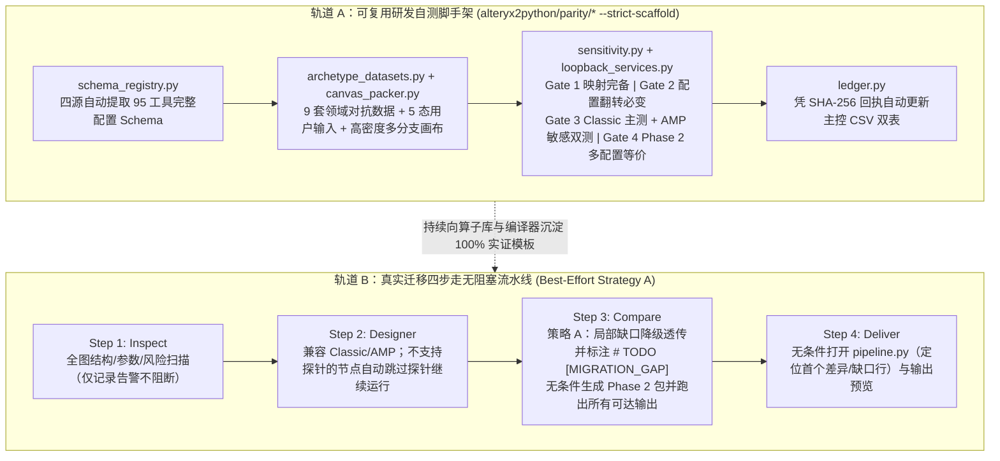

# Alteryx 95 工具全配置穷举覆盖、差分测试数据设计、可复用自测脚手架与无阻塞“四步走”详细设计规范（定稿版）

> **文档定位**：本文档是移交后续研发 Agent（GPT）落地执行的**权威工程设计规范与验收契约**。涵盖：95 个工具全配置穷举机制、差分敏感测试数据集设计、可复用自测脚手架架构、Classic/AMP 分级引擎策略、真实工作流“四步走”去阻塞（策略 A）改造清单、统一主控 CSV 进度账本及分批实施路线图。

---

## 1. 核心背景与三大工程铁律

当前仓库已在 `codex/end-to-end-designer-demo` 分支具备 `WorkflowIR` 解析、Phase 1 运行时与 Phase 2 模块化配置解耦包编译器（[package_compiler.py](../alteryx2python/generator/package_compiler.py)），但仍存在两类突出问题：
1. **工具配置与输入边界屡测屡漏**：现有 [tool-coverage.csv](../reports/node-coverage-2026-11-27/tool-coverage.csv) 只统计样例里碰巧观察到的 XML 哈希；另一分支 `codex/common-tool-configuration-coverage` 上的 811 行明细表（`reports/presentation-smoke/docs/tools/evidence/2026-11-20/common-tools-coverage.csv`）停更于 2026-11-20 且未合入当前分支，仍有 114 项 `Pending enumeration`。加之测试数据长期复用简单样本，无法激活配置开关差异，且缺少系统的 User Input 变体覆盖。
2. **研发设卡误伤真实迁移流程 + 一次性脚本堆积**：大量研发期严格卡点被写死在真实迁移“四步走”链路中，遇到微小差异或未覆盖子项就直接抛错中断，阻拦生成 Python 代码与输出产物；同时 `reports/` 下堆积了大量 `v1..v11` 一次性脚本和临时目录。

为此，后续所有开发工作必须无条件遵守以下 **三大工程铁律**：

### 铁律一：研发期“严脚手架”与真实迁移“宽四步走（策略 A）”彻底解耦
- **研发自测模式（`--strict-scaffold`，仅用于造轮子、跑 CI 与刷 CSV 进度表）**：门禁最严。漏配置映射必挂、测试数据翻转无变化必挂、与 Designer 差一个单元格必挂、Phase 2 泄漏内部依赖必挂——倒逼每个工具配置在交卷前做到精准等价。
- **真实工作流迁移模式（默认模式：`inspect → designer → compare → deliver`）**：撤掉人为门禁，执行**策略 A（最大程度跑出代码与输出）**。遇到局部未覆盖的子选项或非致命差异时，**绝不阻断流程**：始终生成完整的 Phase 1 / Phase 2 Python 代码，按最近似基础语义/结构透传跑完所有可运行分支并产出输出文件，同时在代码注释、运行审计日志和比对报告中精确标出差异节点与代码行号，支撑“先看代码与结果 → 定位差异 → 迭代修正”的闭环。

### 铁律二：真配置穷举 + 真差分敏感数据（拒绝单一数据集通测）
- 工具配置全集必须从本机 Designer 安装目录（宏源码、HTML 插件清单、DLL 元数据、官方样例）**机器静态提取穷举**，严禁靠人工凭印象手列。
- **严禁用同一个通用数据集（如 `transactions.csv`）测试所有工具**：必须按工具语义绑定专用的高熵对抗数据集，并通过 **Config-Flip 配置翻转敏感度自动检测**证明：改变任一功能性配置项，在所绑定的测试数据上必须产生可观测的输出变化，否则判定测试数据不合格。

### 铁律三：只造可复用工程组件，严禁写一次性脚本（Zero Throwaway Code）
- **严禁**在 `reports/`、`tmp/` 或 `scripts/` 下编写针对某一次运行的一次性脚本（如 `collect-*.py`、`fix-*.py`、`inspect-*.ps1`）或手工堆叠 `*-v2`、`*-v3` 目录。
- 所有配置提取器、对抗数据集工厂、多分支测试画布构建器、本机 SMTP/HTTP/Command 测试桩、配置翻转检测器与 CSV 账本回填引擎，**必须设计为正式、参数化、有单元测试覆盖的可复用 Python 模块**，统一挂载到 `python -m alteryx2python.parity` 子命令下。

---

## 2. 双轨架构全景图



---

## 3. 模块一：可复用自测脚手架与测试工具工程规范（拒绝一次性代码）

所有自测基础设施统一构建在 `alteryx2python/parity/` 包内（配合 `tests/test_scaffolding/` 自测），禁止散落外部脚本：

### 3.1 标准模块职责与接口契约

| 模块路径 | 核心职责与可复用组件设计 | 替代掉的历史一次性做法 |
| --- | --- | --- |
| `alteryx2python/parity/schema_registry.py` | **四源配置 Schema 提取与校验引擎**：<br>- `extract_tool_schema(tool_type, alteryx_root) -> ToolConfigSchema`<br>- 自动解析 `RuntimeData/Macros/*.yxmc` (`<Questions>`/`<Actions>`)、`HtmlPlugins/**`、`*Gui.dll`/`*Engine.dll` 符号及 `Samples` 实际 XML 键；<br>- 序列化并校验 `docs/coverage/schemas/<ToolType>.json`，检测任何未登记的 XML 属性。 | 替代人工在 Designer 里逐个点开菜单抄选项及手写零散盘点脚本。 |
| `alteryx2python/parity/archetype_datasets.py` | **确定性对抗数据集与用户输入工厂**：<br>- `build_archetype(dataset_id: str, dest_dir: Path) -> ArchetypeBundle`（生成 `D01`–`D09` 标准输入文件/DataFrame 与元数据）；<br>- `derive_universal_perturbations(bundle) -> dict[str, ArchetypeBundle]`（自动派生 `0-row` 空表、`1-row` 单行、`All-NULL` 列、`Negative-Schema` 错表）；<br>- `generate_five_state_answers(question_manifest) -> dict[str, dict]`（自动为任意 `.yxwz` 生成默认、极值替代、特殊字符转义、空选、非法越界 5 组答案）。 | 替代手工复制粘贴 `transactions.csv` 和手造 `v1..v11` 临时数据目录。 |
| `alteryx2python/parity/canvas_packer.py` | **可复用多配置画布打包构建器**：<br>- `pack_tool_configurations(tool_type, cases, dataset_bundle) -> WorkflowArtifact`<br>- 支持两种复用模式：① **并行扇出画布**（单张 `.yxmd` 内共享同一数据源，并排挂载同一工具的 8–16 种独立配置分支及探针，使 Designer 单次启动即可验证十余种配置）；② **Sample 拓扑克隆注入**（读取官方 Sample 中该节点的上下游连接用法，自动将玩具输入替换为高熵对抗数据）。 | 替代手写几百行只测某一个工具的固定样板代码。 |
| `alteryx2python/parity/loopback_services.py` | **统一本地副作用协议沙盒（Context Managers）**：<br>- `LocalSmtpCaptureServer`（动态空闲端口、捕获 MIME/正文/多附件哈希）；<br>- `LocalHttpTestServer`（可配置路由响应体、Header、状态码 200/404/500、延迟超时及请求录制，供 `Download` 实测）；<br>- `IsolatedCommandSandbox`（生成跨进程确定性回显/写文件/指定退出码测试程序，供 `RunCommand` 与 `Workflow Events` 实测）。 | 替代 `email-native-loopback-v1..v7` 等反复重写的临时服务脚本。 |
| `alteryx2python/parity/sensitivity.py` | **Config-Flip 配置翻转敏感度验证器**：<br>- `verify_config_sensitivity(tool_type, base_case, variant_case, dataset) -> SensitivityResult`<br>- 自动断言修改非 UI 装饰配置后，输出快照或执行结果必然发生预期改变，从源头拦截无效测试数据。 | 替代人工肉眼检查测试是否真的测到了开关分支。 |
| `alteryx2python/parity/ledger.py` | **主控 CSV 进度账本唯一读写器**：<br>- `sync_ledger_from_schemas()`（从 95 个工具 Schema 同步生成标准 Case 行，合并 `11-20` 历史表）；<br>- `attest_ledger_from_receipts(receipt_dirs)`（验签 `acceptance.json` 的工作流/代码/探针 SHA-256 后自动回填状态列，并重新聚合 95 工具总表）。 | 替代人工手改 CSV 文本及口径不一的多份汇总脚本。 |

### 3.2 统一可复用 CLI 命令集

扩展 `alteryx2python/parity/__main__.py`，所有研发自测动作通过以下幂等子命令完成：

```powershell
# 1. 提取/刷新工具配置 Schema 并同步主控 CSV 行定义（零 Pending enumeration 检查）
.venv/Scripts/python.exe -m alteryx2python.parity schema-sync [--tool <ToolType>] [--alteryx-dir "D:/Alteryx"]

# 2. 为指定工具（或分类）生成多配置测试画布 + 对抗数据集，并跑 Gate 1（映射完备）与 Gate 2（Config-Flip 数据敏感度）
.venv/Scripts/python.exe -m alteryx2python.parity check-tool <ToolType> --work-dir reports/tool-matrix/<ToolType>

# 3. 一键执行 Designer 原生采集（自动按工具分级选 Classic / AMP）+ Phase 1 对照（Gate 3）+ Phase 2 多配置隔离验证（Gate 4）
.venv/Scripts/python.exe -m alteryx2python.parity verify-tool <ToolType> --work-dir reports/tool-matrix/<ToolType> --designer-pid <PID>

# 4. 扫描全部有效回执，验签自动回填明细主表与 95 工具汇总表
.venv/Scripts/python.exe -m alteryx2python.parity update-ledger
```

---

## 4. 模块二：95 工具配置穷举规则、文件格式边界与引擎分级

### 4.1 配置组合粒度（1-Way 100% + 耦合轴 2-Way Pairwise）
- **单轴 100% 全覆盖（1-Way）**：`docs/coverage/schemas/<ToolType>.json` 中每个配置轴的每一个合法枚举值、每一个布尔开关（`True`/`False`）、每种输入/输出锚点连接形态，必须在主控 CSV 中拥有独立 `case_id`。
- **关键耦合轴成对正交覆盖（2-Way Pairwise）**：对语义相互影响的配置轴（在 Schema 的 `pairwise_groups` 中声明，如 `CrossTab` 的 `Method × Separator × RetainSpecialChars`、`Join` 的 `JoinMode × 重复键 × 同名列重命名/取消勾选`、`TextToColumns` 的 `SplitMode × ExtraColumns × IgnoreInQuotes`、`DynamicInput` 的 `Action × FileFormat × ErrorBehaviour`）使用确定性 Pairwise 算法生成最小完备组合集。

### 4.2 本地文件格式支持边界（聚焦真实高频格式）
- **纳入完整支持与全配置验证的常见本地格式**：
  1. **分隔符文本**：`.csv`, `.tsv`, `.txt`（全分隔符、UTF-8 / UTF-8-BOM / CP1252 / Latin-1 / GBK / CP932 编码、首行表头 / 无表头 / 空列名与重名列、引号空串 `""` vs 未引空值 `,,`、`Start Data Import on Line`、`Record Limit`）。
  2. **Excel 工作簿**：`.xlsx`, `.xlsm`（及常见 `.xls` 读取），覆盖指定 Sheet、非首 Sheet、显式范围 `Sheet1$A2:F50`、命名区域、尾部空列、覆盖 Sheet / 覆盖文件 / 追加范围、跨文件物理列类型一致性检查。
  3. **Alteryx 原生格式**：`.yxdb`（Classic YXDB 读写，覆盖工作流落地与 `DynamicInput` `.yxdb` 模板）。
  4. **基础结构与二进制文件**：本地 `.xml`、`.json` 及 `Blob` 原始字节流读写。
- **明确不纳入实现范围的冷门/外部格式**（在 Schema 与 CSV 中统一标记为 `out_of_scope_format` 或 `external_prerequisite`）：`Parquet`、`Avro`、`SQLite`、`Calgary (.cydb)`、空间矢量专有格式（`SHP`/`TAB`）、需外部服务凭据的 `ODBC/Database/Cloud Connectors`。

### 4.3 Classic vs. AMP 三级引擎测试与兼容策略

| 引擎分级 | 工具范围（共 95 个） | 研发自测脚手架（Gate 3）执行策略 | 真实迁移运行态（遇到 `RunWithE2=True` 工作流） |
| --- | --- | --- | --- |
| **Tier 1：AMP 独占（1 个）** | `ControlContainer` | **仅在 AMP 下测试**（Classic 下 Designer 原生不支持）。 | 正常按 AMP 控制流与日志流语义执行。 |
| **Tier 2：AMP 敏感（14 个）** | **排序与字符规则**：`Sort`, `Rank`, `Unique`, `CrossTab`, `Tile`, `FuzzyMatch`<br>**多流/分块顺序与聚合**：`Join`, `JoinMultiple`, `Union`, `AppendFields`, `Summarize`（`First`/`Last`/`Concat`）<br>**随机抽样流**：`CreateSamples`, `RandomRecords`, `Sample`（随机/抽样模式） | **Classic 全配置必测 + AMP 关键差异配置双测**（核对 Collation 大小写/符号顺序、多对多连接保序、分组首尾选取、AMP 随机哈希种子流）。 | Python 运行时与 Phase 2 `config.toml` 读取原工作流 `RunWithE2` / `EnableEngine2` 标记自动适配对应引擎细节，**绝不因开启 AMP 报错**。 |
| **Tier 3：引擎无关（80 个）** | `Formula`, `Filter`, `Select`, `RegEx`, `TextToColumns`, `DateTime`, `JSONParse`, `XMLParse`, `DataCleanse*`, `Imputation`, `MultiRowFormula`, `MultiFieldFormula`, `Transpose`, `Interface`, `Blob*` 等其余全部工具 | **统一用 Classic 引擎单步直读 `.yxdb` 高效测透全部配置**（免去二次导出耗时）。 | 即使原工作流开启了 AMP，Python 转换与执行 100% 透明放行；Step 2/3 若需采集原生 AMP 探针则自动转换（局部探针缺失仅记 `incomplete` 不中断）。 |

---

## 5. 模块三：差分敏感测试数据与五态 User Input 设计规范

### 5.1 配置翻转敏感度定律（Config-Flip Sensitivity Law）

在 `sensitivity.py`（Gate 2）中强制执行：对任意非 `ui_cosmetic` 的配置变体 $C_{\text{variant}}$ 与其对照基线 $C_{\text{base}}$，所绑定的数据集 $D$ 必须满足：

$$\text{Result}(D, C_{\text{variant}}) \neq \text{Result}(D, C_{\text{base}})$$

若翻转某配置项后输出完全无变化，自测直接报 `NonDiscriminatingDatasetError` 失败，禁止写入 CSV 通过记录。可借用官方 Sample 的节点连接拓扑（Sample Node Usage），但输入源必须替换为下列专用对抗数据集。

### 5.2 九大领域级高熵对抗数据集规格（`archetype_datasets.py`）

1. **`D01_RELATIONAL`（供 `Join`, `JoinMultiple`, `Union`, `Unique`, `AppendFields`, `FindReplace`, `MakeGroup`）**
   - 包含：`1:1`/`1:N`/`M:N` 重复键、左右孤儿行、复合键 `(NULL, "A")` vs `("", "A")` vs `("A ", "A")`、大小写碰撞 `"us"` vs `"US"`、前导零文本 `"0012"` vs `"12"`、同名非键列冲突、列序错位、宽窄数值/字符串类型合并、16/17 行源表阈值。
2. **`D02_NUMERIC_STATS`（供 `Formula`, `MultiFieldFormula`, `Summarize`, `WeightedAvg`, `Imputation`, `Tile`, `MultiFieldBinning`, `Rank`, `RunningTotal`）**
   - 包含：正负数、`0`、`-0.0`、`Int64` 极值、半数舍入边界 `1.5, 2.5, -2.5, 2.675`、含 `NULL` 分组与全 `NULL` 分组、0 权重与负权重、4 种并列结构（首名并列、中间 3 连并列、末名并列、含 NULL）、极度偏态离群值 + 常数列 + 总行数少于桶数（如 3 行分 5 桶）。
3. **`D03_TEXT_DIRTY`（供 `DataCleansePro`, `DataCleansing`, `RegEx`, `TextToColumns`, `Sort`, `FuzzyMatch`, `AutoField`）**
   - 包含：首尾空格、连续空格、`\t`、`\r\n`、标点数字混排、中日韩/法德重音字符（`é, ß`）/Emoji、引号内分隔符 `"a,b",c`、括号内分隔符 `a,(b,c)`、连续空分隔符 `a,,b`、额外溢出列、数字串 `"2"` vs `"10"`、各整数/浮点/布尔阈值边界字符串（精确触发 `AutoField` 各类型分支）。
4. **`D04_TEMPORAL`（供 `DateTime`, `DateTimeNow`, `GenerateRows`, 日期表达式函数）**
   - 包含：闰日 `2024-02-29`、平年 `2025-02-28`、月末 `01-31` 加减月、跨午夜 `23:59:59`、多种月份全称/缩写与自定义格式、非法日期文本与空串。
5. **`D05_WINDOW_RESHAPE`（供 `MultiRowFormula`, `Sample`, `SelectRecords`, `RandomRecords`, `CreateSamples`, `OversampleField`, `RecordID`, `MakeColumns`, `Arrange`, `Transpose`, `CrossTab`）**
   - 包含：0 行/1 行/2 行/7 行/50 行不均衡分组、组首组尾跨多行越界引用（区分 `0/Empty`、`Null`、`Nearest`）、90%:10% 类别不平衡列、含空格/特殊符号/中文的动态表头值及 `NULL` 表头值。
6. **`D06_SEMI_STRUCTURED`（供 `JSONParse`, `XMLParse`）**
   - 包含：深层嵌套 JSON（含 `null`、布尔、科学计数法、空数组/空对象、键名含点号）、XML 多层同名重复子节点、属性 `@attr`、自闭合空标签 `<a/>`、外层 `OuterXML`、截断损坏片段。
7. **`D07_FILE_IO_COMMON`（供 `DbFileInput`, `DbFileOutput`, `DynamicInput`, `Directory`, `BlobInput`, `BlobOutput`, `Base64Encoder`）**
   - 包含：多编码 CSV（空表头 `,a,,a` / 无表头 / 引号空串 vs NULL / 行偏移 / 行上限）、多 Sheet 与 Cell Range 的 `.xlsx`/`.xlsm`、**同名列但物理类型冲突的两个 `.xlsx` 文件**（如文件 A 列为数值、文件 B 同名列含字符串，触发 Designer Schema Mismatch）、`.yxdb` 文件、含 `\x00\xff` 及 UTF-16 BOM 的二进制文件、嵌套大小写扩展名目录树。
8. **`D08_USER_INPUT_5STATE`（供 15 个 `Interface` 工具 + `DynamicRename/Select/Replace`, `Detour`, `ControlContainer`, `Message`, `ExpectEqual`, `Macro*`）**
   - 强制覆盖 **5 态用户输入矩阵（5-State User Input Suite）**：
     1. `default`：默认保存参数；
     2. `alternate_boundary`：另一合法枚举分支 / 数值上下限极值 / 多选组合 / 跨月跨年日期；
     3. `special_escaping`：含双引号 `"`、单引号 `'`、反斜杠、中文、带空格目录路径、正则元字符；
     4. `empty_deselected`：空文本 / 复选与列表全不选 / 绑定仅含表头的 0 行输入文件；
     5. `invalid_expected_error`：触发 `Error` 工具阻断、缺失路径、越界输入、`DynamicReplace` 未匹配值 `Error` 模式。
9. **`D09_REPORTING_SIDE_EFFECT`（供 13 个 `Reporting` 工具 + `Email`, `Download`, `RunCommand`, `JupyterCode`）**
   - 包含：分组与非分组报表流、HTML 特殊转义字符 `<>&"`、0 行空报表、`LocalSmtpCaptureServer` 多附件投递、`LocalHttpTestServer` 多状态码与自定义 Header 响应、`IsolatedCommandSandbox` 正常/非零退出、多输入多输出 `#1..#5` Python Notebook。

### 5.3 四项自动叠加的通用边界微扰（Universal Perturbations）
`check-tool` / `verify-tool` 对每个工具自动派生运行：① `P_EMPTY_0ROW`（0 行保 Schema）、② `P_SINGLE_1ROW`（单行边界）、③ `P_ALL_NULL_COL`（目标列全 NULL 防 dtype 漂移）、④ `P_NEGATIVE_SCHEMA`（缺列或超阈值预期报错等价）。

---

## 6. 模块四：真实迁移“四步走”去阻塞与策略 A（Progressive Best-Effort）实现契约

### 6.1 策略 A（最大程度跑出 Python 代码与最终输出）核心规则

在面向真实业务工作流的默认模式（`strict_scaffold=False`）下，无论是 `cli migrate`、`cli readable` 还是 `presentation.ps1` 的四步命令（`inspect → designer → compare → deliver`），必须满足：

1. **Phase 2 代码 100% 必产出**：
   - `ModularPackageGenerator.generate(..., best_effort=True)`（默认开启 `best_effort=True`，仅在研发门禁 Gate 4 下传 `best_effort=False`）：
   - 自动根据图内节点推断默认 `delivery_profile`（如存在 `PortfolioComposer*`/`Email` 且未显式指定时，按输出后缀 `.xlsx` 或默认自动选用 `xlsx-table-v1` / `html-draft-v1`）。
   - 当个别节点的某个冷门子配置、未知表达式函数或次要属性触发 `UnsupportedLowering` / `UnsupportedExpressionError` 时，**严禁中止整图编译**：
     - 其余所有正常节点照常生成干净、向量化的 Native Pandas 函数；
     - 问题节点生成一个带醒目结构化注释的降级 stage 函数：
       ```python
       def step_node_25_fallback(df: pd.DataFrame) -> pd.DataFrame:
           # TODO [MIGRATION_GAP: Node #25 (PortfolioComposerTable) - Grouped bar-graph table style not yet lowered; passing frame through]
           return df.copy()
       ```
     - 同时将该缺口写入 `package/manifest.json` 的 `"migration_gaps"` 数组（记录 `node_id`, `tool_type`, `reason`, `fallback_behavior`, `function`, `line`）。
2. **Phase 1 与 Phase 2 运行时最大程度产出输出文件（独立分支绝不连坐）**：
   - 只要降级节点的输入表结构可以继续流向下游（如未支持的样式修饰、次要清洗选项、诊断型 `Message`），按基础语义或安全透传继续执行下游算子并写出结果文件，同时在 `audit_utils.py` 运行日志中发射 `GAP_FALLBACK` 级别告警记录；
   - 若某单一支路遇到物理上无法恢复的运行期异常（如某分支引用的外部文件缺失），捕获该支路异常并记录失败节点，**保持其他独立支路继续执行完毕并落盘各自的输出文件**。
3. **四步走全链路零误拦改造点清单**：

| 代码文件与位置 | 必须移除的错误拦截（Old Blocker） | 改造后的无阻塞行为（New Best-Effort Behavior） |
| --- | --- | --- |
| [runner.py](../alteryx2python/parity/runner.py) `prepare()` | 遇到 `SIDE_EFFECT_TOOLS`、动态路径 `DynamicInput`/`BlobInput`、未白名单 Event、`MultiFile=True`、`.xlsm`/`.xls` 直接 `raise ValueError`。 | 支持 `.xlsm`/`.xls`；无法注入中间 YXDB 探针或重写输出的节点仅跳过该节点探针（记入 `manifest["skipped_probes"]`）；未显式放行的外部命令 Event 在测试副本中安全跳过并记录告警，保证 Designer 与 Python 顺利跑通。 |
| [migration.py](../alteryx2python/parity/migration.py) `prepare_migration()` | App `Date` 无默认日期、或 `Action` 解析出的路径在暂存目录外直接 `raise ValueError`。 | 无默认日期时使用当日或提示占位值并记入 `warnings`；外部有效本地路径只读快照或记录非隔离提示，不中断准备流程。 |
| [presentation.py](../alteryx2python/parity/presentation.py) `_export_amp_probes()` | AMP 探针转换部分缺失或超时直接 `raise ValueError` 卡死第 3 步 `compare`。 | 成功转换的探针照常逐节点比对；缺失探针记为 `incomplete_probe`，继续完成后续比对与交付。 |
| [delivery.py](../alteryx2python/parity/delivery.py) `verify_delivery()` | ① 输出重名抛错；② `first["status"] != "success"` 时直接抛错跳过整个 Phase 2 编译和运行！ | ① 同名输出自动加 `<node_id>_` 前缀消歧；② **无论 Phase 1 状态是 `success`、`failed` 还是与 Designer `mismatch`，一律继续生成 `package/` 并运行独立子进程产出 `delivery-output/`**，完整保留各阶段结果供排障。 |
| [presentation.py](../alteryx2python/parity/presentation.py) `_deliver()` | 仅当 `result["status"] == "match"` 时才打开编辑器与输出文件。 | 只要 `pipeline.py` 存在，**无条件用 VS Code 打开 `pipeline.py`，并优先自动跳转到第 1 个 `mismatch` 节点或第 1 个 `MIGRATION_GAP` 所在的代码行**，同时打开已产出的输出文件预览。 |

### 6.2 唯一允许保留的 3 类真实硬阻塞（True Blockers）
仅当以下物理前提缺失、根本无法启动时才返回阻塞错误：
1. 源工作流文件（`.yxmd`/`.yxwz`）不存在或 XML 严重损坏无法解析出节点图；
2. 唯一核心上游本地数据文件在磁盘上不存在（且未开启空表推演/允许缺失选项）；
3. 唯一数据源为直连远程受控数据库/云接口（如无本地快照的远程数据库查询）且当前环境无连接凭据。

---

## 7. 模块五：主控 CSV 进度账本重构与防造假校验规范

### 7.1 历史表合流与双表联动结构

在仓库正式受 Git 追踪的 `docs/coverage/` 目录下建立唯一权威进度账本（废弃脱离分支的旧表）：

1. **`docs/coverage/tool_configuration_matrix.csv`（逐配置项明细主表，唯一事实源）**
   - 启动时由 `ledger.py` 自动合流 `codex/common-tool-configuration-coverage` 分支上的 811 行历史定义与 11-27 已通过回执，并用 `schema_registry.py` 补齐全部 95 工具 + 9 项工作流特性的所有离散配置与用户输入变体。
2. **`docs/coverage/tool_coverage_summary_95.csv`（95 工具汇总视图，100% 自动聚合生成）**
   - 实时聚合每个工具的：`总配置项数`、`纳入支持数`、`Gate2 数据敏感通过数`、`Gate3 Designer↔Phase1 通过数`、`Gate4 Phase1↔Phase2 通过数`、`完成率 (%)`、`待完成 Case ID`。

### 7.2 明细主表 22 列标准字段定义

| 区域 | 列名 | 取值约束与说明 |
| --- | --- | --- |
| **左半区：架构契约列**<br>（由 Schema 同步生成） | `case_id` | 唯一稳定键，如 `CrossTab-Method-PercentRow`、`DropDown-Input-SpecialChars` |
| | `priority` | `P0` / `P1` / `P2` |
| | `category` | 9 大工具分类 + `WorkflowFeatures` |
| | `tool_type` | 95 工具标准内部名（如 `DbFileInput`, `PortfolioComposerTable`） |
| | `designer_name` | Designer 面板显示名 |
| | `engine_tier` | `amp_only` (Tier 1) / `classic_and_amp` (Tier 2) / `classic_primary` (Tier 3) |
| | `config_axis` | 配置轴名称 |
| | `xml_path` | 对应原始 XML 属性/节点路径 |
| | `option_scenario` | 具体枚举取值、布尔分支或 Pairwise 组合描述 |
| | `user_input_state` | `static` / `default` / `alternate_boundary` / `special_escaping` / `empty_deselected` / `invalid_expected_error` |
| | `support_policy` | `supported` / `out_of_scope_format` / `external_prerequisite` / `ui_cosmetic` / `non_deterministic` |
| | `dataset_id` | 绑定的领域对抗数据集编号（`D01`–`D09`） |
| | `sample_usage_ref` | 借鉴拓扑结构的官方 Sample 相对路径（可为空） |
| **右半区：机器证据列**<br>（严禁手改，仅由 `ledger.py` 验签回执写入） | `gate1_schema_mapped` | `PASS` / `FAIL` / `PENDING`（Parser + Phase1 + Phase2 均显式处理，无 `best_effort` 降级残留） |
| | `gate2_config_flip` | `PASS` / `NON_DISCRIMINATING` / `N/A`（数据集翻转敏感度证明） |
| | `gate3_designer_classic` | `PASS` / `MISMATCH` / `N/A` / `UNVERIFIED` |
| | `gate3_designer_amp` | `PASS` / `MISMATCH` / `N/A` / `UNVERIFIED`（Tier 1 & Tier 2 必填 `PASS`） |
| | `gate4_phase2_native` | `PASS` / `COMPILE_GAP` / `MISMATCH` / `UNVERIFIED`（严格模式零 Gap + 多配置切换一致） |
| | `overall_status` | `VERIFIED` / `IN_PROGRESS` / `MISMATCH` / `OUT_OF_SCOPE` |
| | `fixture_workflow` | 受控可重放测试工作流路径（`tests/fixtures/tool_matrix/<tool>/...`） |
| | `receipt_path` | 自动化验证回执 JSON 路径 |
| | `receipt_sha256` | 回执内容与工作流/运行时摘要签名 |

### 7.3 账本防虚报单元测试（`tests/test_coverage_ledger_integrity.py`）
- 纳入每次 `pytest` 必跑项：
  1. 校验 95 个工具无任何工具缺失 Schema 文件，无任何 `Pending enumeration` 占位行；
  2. 校验每一条 `overall_status == "VERIFIED"` 的记录：`gate1` 与 `gate4` 必为 `PASS`（且 `migration_gaps` 为空），非 `ui_cosmetic`/`non_deterministic` 行的 `gate2_config_flip` 必为 `PASS`，Tier 1/2/3 对应的 `gate3` 引擎列必为 `PASS`，且 `receipt_path` 签名有效。

---

## 8. 模块六：移交 GPT 的分批实施计划与直接可用提示词

### 8.1 六个有序交付批次（Work Packages）

| 批次 | 交付目标 | 包含范围 | 核心验收指标 |
| --- | --- | --- | --- |
| **WP-0：可复用脚手架底座 + 四步走去 Blocker 改造** | 先打通“策略 A 无阻塞四步走”与可复用测试工具链 | 1. 完成第 6 节全部 6 处去 Blocker 与 Phase 2 `best_effort` 策略 A 改造；<br>2. 实现第 3 节全部 6 个可复用模块（`schema_registry`, `archetype_datasets`, `canvas_packer`, `loopback_services`, `sensitivity`, `ledger`）及单元测试；<br>3. 提取全部 95 工具 Schema，合流生成初始主控 CSV 双表并回填已有通过证据；修复 `Message.yxmd` 终态锚点问题。 | 任意含局部缺口的工作流跑四步走均可产出完整 `pipeline.py`、可达输出及代码行定位；主控 CSV 零 `Pending enumeration`；无一次性脚本。 |
| **WP-1：In/Out 与常见文件/二进制全配置** | 11 个 I/O 与二进制工具 100% 配置闭环 | `DbFileInput`, `DbFileOutput`, `DynamicInput`, `Directory`, `TextInput`, `DateTimeNow`, `BrowseV2`, `BlobInput`, `BlobOutput`, `BlobConvert`, `Base64Encoder` | 跑通 `.csv/.tsv/.txt`、`.xlsx/.xlsm/.xls`（含同名列物理类型冲突报错）、`.yxdb` 及 `Blob` 全部配置；冷门格式标 `out_of_scope_format`。 |
| **WP-2：Preparation 核心准备全配置** | 21 个数据准备工具 100% 配置闭环 + 向量化提纯 | 全部 21 个 `Preparation` 工具 | Classic 全绿；`Sort`, `Unique`, `Rank`, `Tile`, `Sample`, `CreateSamples`, `RandomRecords` 通过 AMP 双测；常规 `MultiRowFormula`/`MultiFieldFormula`/`DataCleansing` 下沉为原生向量化 Pandas。 |
| **WP-3：Join、Parse 与 Transform 全配置** | 19 个关联/解析/重塑工具 100% 配置闭环 | 全部 7 个 `Join` + 4 个 `Parse` + 8 个 `Transform` 工具 | 30+ `Summarize` 动作、15 种 `CrossTab` 聚合、`RegEx` 4 模式、`TextToColumns` 溢出/引号策略全绿；`Join`, `JoinMultiple`, `Union`, `AppendFields`, `Summarize`, `CrossTab`, `FuzzyMatch` 通过 AMP 双测。 |
| **WP-4：Interface、Macro、动态工具与控制流全配置** | 28 个交互/动态/控制工具 + 9 项工作流特性闭环 | 15 个 `Interface` + `DynamicRename/Select/Replace`, `BlockUntilDone`, `ControlContainer`, `Detour`, `DetourEnd`, `ExpectEqual`, `FieldInfo`, `JSONParse`, `Message`, `Documentation`(2) + 9 项特性 | 5 态用户输入矩阵全绿；`Action` 全模式（含 Formula/RawXML/File/Container）跑通；`DynamicReplace` 解除静态 `TextInput` 限制；宏内 `operations` 透传；`ControlContainer` AMP 验证通过。 |
| **WP-5：Reporting 与外部副作用交付全配置** | 17 个报表与外部交互工具 100% 闭环 | 13 个 `Reporting` 工具 + `Email`, `Download`, `RunCommand`, `JupyterCode` | 自动推断 `delivery_profile`；分组/非分组/批次 HTML & XLSX 报表可见内容一致；基于 `loopback_services.py` 完成 Email SMTP、Download HTTP、RunCommand 沙盒及多锚点 JupyterCode 全配置实测；主控 CSV 全部 `supported` 行达成 `VERIFIED`。 |

### 8.2 直接复制交给 GPT 的开工指令模板（Handoff Prompt）

您可以直接将以下指令发给 GPT 启动执行：

```text
请先完整阅读仓库中的设计规范 `docs/full_configuration_coverage_design.md` 以及 `.trellis/spec/backend/` 下的编码契约，严格按照该设计规范从 WP-0 开始依序推进 WP-0 → WP-5，直至 95 个工具的全部纳入范围配置在主控账本 `docs/coverage/tool_configuration_matrix.csv` 中达成 100% VERIFIED。

执行硬性要求：
1. 严禁编写一次性脚本或堆叠 reports/*-v2..v11 临时目录：所有配置提取器、9 套对抗数据集工厂、多分支画布打包器、本地 SMTP/HTTP/Command 测试沙盒、Config-Flip 敏感度检查器与 CSV 账本引擎，必须按设计文档第 3 节实现为 `alteryx2python/parity/` 下有单测覆盖的可复用模块与统一 CLI 子命令。
2. 严格区分双轨模式：
   - 研发自测脚手架（`--strict-scaffold`）必须强制通过 Gate 1~4（特别是 Config-Flip 数据区分度检查，绝不允许用改配置输出不变的退化数据混关；Tier 1/2 工具完成 AMP 验证，Tier 3 工具用 Classic 高效验证）。
   - 真实迁移“四步走”（默认模式）必须按第 6 节清除现有 6 处过度 Blocker 并实现策略 A（Progressive Best-Effort）：遇到未覆盖边角配置绝不阻拦生成 Phase 2 Python 包和可达分支输出，用 `# TODO [MIGRATION_GAP]`、manifest 行号映射与 compare 差异报告呈现。
3. 严禁手工修改 CSV 右半区状态列，所有状态必须由 `parity update-ledger` 验签真实回执自动写入，并通过 `tests/test_coverage_ledger_integrity.py` 与全量 `pytest` 校验。
4. 每完成一个 Work Package（先从 WP-0 开始），运行全量测试并汇报当前 `docs/coverage/tool_coverage_summary_95.csv` 的完成度指标。
```
