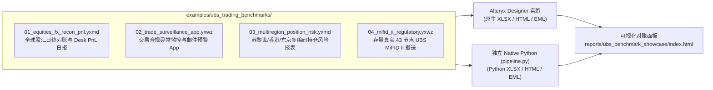

# Alteryx2Python 轻量化路线与 UBS 金融交易实战测评方案

> **文档定位**：替代此前过度复杂的“95 工具数千配置穷举账本”方案，转向**系统减负瘦身 + 面向真实投行/交易业务（UBS Trading, Recon, Surveillance & Regulatory Reporting）的端到端可视化测评**。所有代码与产物必须简洁、可读、让用户一眼看到真实的 Python 代码与业务报表结果。

---

## 1. 核心纠偏：给系统做减法（De-bloat Principles）

### 1.1 立即停止的过度工程化工作
1. **停止全语种与冷门编码穷举**：不再调用系统 API 枚举 275 个 Windows Locale（LCID），不再测试 EBCDIC 等冷门代码页，不再对位掩码做 `2^N` 组合爆炸测试。
2. **停止 DLL 反编译与 2,117 行哈希账本刷表**：冻结 `schema_sources.py`、`ledger.py` 与 `docs/coverage/tool_configuration_matrix.csv` 的穷举扩张（保留现有已通过单测不破坏即可，不再为其投入开发精力）。
3. **移除繁琐门禁与晦涩回执**：日常转换与场景测评一律采用无阻塞模式（Best-Effort），不因次要元数据或探针限制阻断 Python 代码与最终报表的生成；交付产物面向人类阅读，而非仅输出 SHA-256 哈希 JSON。

### 1.2 极简、够用的支持边界
- **字符编码白名单（仅保 4 类高频编码）**：
  - `UTF-8`（`65001`，默认主力）
  - 中文编码（`GBK / GB18030 / CP936`、`Big5`）
  - 日文编码（`Shift-JIS / CP932`）
  - 英文/西欧默认编码（`Windows-1252 / ISO-8859-1 (28591)`，如存量 `mapping.csv` 所用）
- **本地文件与交付物格式（仅保办公主流格式）**：
  - 输入/输出表：`.csv` / `.tsv` / `.txt`、`.xlsx` / `.xlsm`、`.yxdb`
  - 业务报表与通知：格式化 `.html` 报表、多页签 `.xlsx` 报表、`.eml` 邮件（含 HTML 正文与附件）
- **Classic 与 AMP 引擎极简兼容规则**：
  - **Python 生成侧**：无论源工作流是 Classic（`RunWithE2="False"`）还是 AMP（`RunWithE2="True"`），一律直接转换，绝不因开启 AMP 报错；`Join` 统一修复 Classic 重复键平局次序（`by_position=False` 时按 `(__right_index, __left_index)` 稳定平局后再按连接键升序排列）。
  - **结果比对侧**：Classic 模式及 Phase 1 ↔ Phase 2 保持严格逐行比对；当对比 Designer **AMP 原生运行结果**与 Python 结果时，对 AMP 并行哈希无序算子（如 `Join`、`JoinMultiple`、`Union`）直接采用**无序行多重集等价比对（Row Multiset Equivalence：列名、类型、行数一致，双方按全列规范化排序后逐单元格相等）**，绝不编写拟合 AMP 内部哈希分桶顺序的复杂代码。

---

## 2. UBS 金融交易与监管报表实战基准集（4 大端到端场景）

在仓库新建结构清晰、自包含的目录 `examples/ubs_trading_benchmarks/`，提供确定性数据构建脚本 `prepare_datasets.py`（基于公开金融市场标的结构生成贴近真实柜台的多表数据，零外部 API Key 依赖，一键生成所有输入文件）。



### 场景 1：全球股票与外汇日终对账及 Desk PnL 归因日报
- **工作流文件**：`examples/ubs_trading_benchmarks/01_equities_fx_recon/equities_fx_recon_pnl.yxmd`
- **业务场景**：模拟 UBS Global Markets 日终交易台（Equities Cash、FX Spot、Derivatives Desk）将前台 OMS 成交流水与外部清算行账单进行核对，折算 CHF 本币净额与已实现盈亏，分离未平账异常单（Recon Breaks），并生成管理层日报。
- **输入数据集（约 1,500～2,000 行）**：
  1. `oms_executions.csv`（UTF-8）：含 `TradeID, OrderID, TradeDate, Desk, Trader, ISIN, Ticker, Side, Quantity, ExecPrice, TradeCcy (USD/CHF/EUR/HKD/JPY), Counterparty`（包含同一 `OrderID` 多笔拆单成交的重复关联键、空备注与负向冲正单）；
  2. `prime_broker_clearing.xlsx`（多 Sheet）：`Clears` 页签为清算确认流水（故意设计约 20 笔金额尾差、漏单与多单），`FeeSchedule` 页签为各市场佣金与印花税率（bps）；
  3. `fx_rates_chf.csv`：各交易币种兑 CHF 日终折算汇率；
  4. `security_master.csv`：证券主数据与资产分类。
- **核心算子链路**：
  `DbFileInput` (CSV + XLSX 多 Sheet) → `Select` / `AutoField` / `DataCleansing` → `Join`（挂接证券主数据、费率表与 FX 汇率） → `Formula`（计算 `Gross_Notional_CHF`、`Commission_CHF`、`Net_Settlement_CHF`、`Realized_PnL_CHF`） → `Join`（OMS vs Broker 对账：`Join` 锚点校验金额差 `Abs(Diff) > 0.01`，`Left`/`Right` 孤儿锚点经 `Union` 合并为完整 **Unmatched Trade Breaks** 清单） → `Summarize` + `CrossTab`（生成 `Desk × AssetClass` PnL 汇总透视表） → **Reporting 工具链（`ReportHeader` + `PortfolioComposerTable` + `Layout` + `PortfolioComposerRender`）+ `DbFileOutput`**。
- **可见输出产物**：
  - `desk_pnl_daily_report.html`：带标题、汇总透视表与异常单摘要的可视化 HTML 报表；
  - `trade_recon_pack.xlsx`：包含 `Desk_PnL_Summary` 与 `Recon_Breaks` 双页签的 Excel 对账工作簿。

---

### 场景 2：交易合规监控、对倒/拆单识别与超限预警 App（`.yxwz`）
- **工作流文件**：`examples/ubs_trading_benchmarks/02_trade_surveillance_app/trade_surveillance_alert.yxwz`
- **业务场景**：模拟 UBS Market Surveillance 合规官运行的交互式 Analytic App——按指定交易日、业务部门与大额阈值筛查疑似自成交对倒（Wash Trade）、拆单规避限额（Structuring / Split Orders）及偏离市场 VWAP 滑点过大的异常交易，自动产出合规审查表并发送带附件的预警邮件。
- **输入数据集（约 2,000 行）**：
  - `intraday_order_blotter.csv`：含时间戳 `ExecTimestamp`、`ClientAccount`、`TraderID`、`Desk`、`Symbol`、`Side`、`Qty`、`ExecPrice`、`MarketVWAP`、`Status`。
- **App 交互参数（实测两组运行参数：默认参数 vs 收紧阈值参数）**：
  - `Date`（监控日期）、`DropDown`（监控 Desk，如 `ALL` vs `APAC_EQ`）、`NumericUpDown`（大额累计敞口红线，默认 `2,000,000` CHF，替代组 `500,000` CHF），通过 `Action` 动态更新下游过滤与公式阈值。
- **核心算子链路**：
  `DbFileInput` → `Filter`（过滤有效成交与目标 Desk/日期） → `Sort`（按 `ClientAccount, Symbol, ExecTimestamp` 升序） → `MultiRowFormula`（识别同账户同标的短时反向买卖对倒标记 `Is_Wash_Suspect`，以及滑动累计拆单金额 `Rolling_Split_Notional`） → `Formula`（计算 `VWAP_Slippage_Bps` 与综合风险等级 `HIGH / MEDIUM`） → `Filter`（筛选触发任一合规规则的高危记录） → `Sort` + `RecordID` + `Sample`（提取 Top 50 重点核查单） → **`PortfolioComposerTable` + `Email`（经本地 `LocalSmtpCaptureServer` 捕获真实 `.eml` 报文及 HTML/CSV 附件）+ `DbFileOutput`**。
- **可见输出产物**：
  - `surveillance_breach_alerts.csv`：命中的高危合规告警明细；
  - `compliance_alert.eml` 及自动提取的 `compliance_alert_body.html`（可在浏览器直接点开审阅邮件正文与表格排版）。

---

### 场景 3：跨区柜台（UTF-8 / 中文 / 日文）持仓归集与风险敞口报表
- **工作流文件**：`examples/ubs_trading_benchmarks/03_multiregion_position_risk/multiregion_position_risk.yxmd`
- **业务场景**：聚焦跨国银行最真实的**中日英多编码文件混读**与风险汇总（Zurich 柜台导出 UTF-8、Hong Kong/Shanghai 柜台导出 `GBK/CP936` 含中文股票简称如 `腾讯控股`/`贵州茅台`、Tokyo 柜台导出 `Shift-JIS/CP932` 含日文证券名如 `トヨタ自動車`/`ソニーグループ`），统一清洗归集后计算集中度与近似 VaR 风险敞口。
- **核心算子链路**：
  3 路不同 CodePage 的 `DbFileInput`（`65001` UTF-8、`936` 简体中文、`932` 日文） → `DynamicRename` / `Select`（标准化各地区列名差异） → `Union`（合并全球持仓） → `Join`（关联市场波动率 `Annualized_Vol` 与汇率） → `Imputation`（空缺波动率按资产类别均值填充） → `Formula`（计算 `Market_Value_CHF` 与 99% 1日参数法 `VaR_99_1D_CHF`） → `Tile`（按市值敞口分 5 档风险分位桶） + `Sort` → `Summarize`（按区域、资产类别、风险分位汇总） → **Reporting 渲染输出 `global_position_risk.html` + `consolidated_positions.xlsx`**。
- **可见输出产物**：
  - `global_position_risk.html`（验证中日文字符在 HTML 报表中无乱码、数值汇总准确）；
  - `consolidated_positions.xlsx`（全球持仓明细与风险分档表）。

---

### 场景 4：存量真实 UBS 监管工作流实测（[MIFID II.yxwz](../examples/sample_workflows/MIFID%20II.yxwz)）
- **源文件**：仓库现有 [examples/sample_workflows/MIFID II.yxwz](../examples/sample_workflows/MIFID%20II.yxwz)（43 个节点，`RunWithE2="True"` AMP 引擎，真实 UBS MiFID II 手工补报模板生成工具）。
- **工作流真实拓扑解析与仿真配数方案**（保持原工作流 43 节点业务逻辑与公式原封不动，仅在测试暂存副本中将原路径 本机工作目录 与内网 URL 指向本地仿真夹具）：
  1. **上游输入工作簿** `ROB-102928 Input template - EQ.xlsx`（`Sheet1`，通过 `File Browse (10)` + `Action (11)` 传入节点 `4`）：构造 10～15 笔典型欧洲股票/衍生品交易，包含节点 `14` / `17 (Cleanse.yxmc)` / `60` 所需的精确列：`Product Classification, Internal Identifier, Regulation, tradeDomain, tradeId, tradeVersion`（覆盖 `Internal Identifier` 为空时由节点 `60` 自动拼接 `tradeDomain + "_" + tradeId + "_" + tradeVersion` 的分支）。
  2. **本地 OMR 接口仿真服务**（对接节点 `12` + 节点 `16 Download`）：利用现有的 `LocalHttpTestServer` 监听本地端口，接收节点 `16` 发出的 `HTTP POST`（含 `Content-Type: application/json`、由 `Text Box (57)` 注入的 `Cookie` 请求头、以及节点 `12` 构造的 `JSON` 请求体），按 `tradeId` 返回贴合节点 `41..46` 字段契约的嵌套 JSON 报文（含 `result.exceptions[0]` 下的 `assetClass, buyerId, executingEntityId, instrumentId, price, priceCurrency, quantity, reportStatus, tradingCapacity, tradingDateTime, transactionReferenceNumber, venue, tradeValidationRules` 等全部字段）。
  3. **MiFID II 87 列标准映射表** `mapping.csv`（对接节点 `48`，`CodePage=28591`）：严格按照节点 `49 (Join)` 与节点 `51/53` 的契约生成完整 87 行映射表（列名为 `SourceField,OutputOrder,TargetField`，完整覆盖节点 `53` 声明的 `001_Report_Status` 至 `087_Data_Category` 全部 87 个监管目标字段）。
  4. **全链路验证点**：完整跑通 `FileBrowse/TextBox/Action` → `Cleanse.yxmc` → `Download (POST)` → `JSONParse` → `Formula (REGEX_Replace)` → `Filter` → `CrossTab` → `DynamicRename (Formula)` → `RecordID` → `Transpose` → `Join` + `Union`（补齐未出现列） → `CrossTab` → `DynamicRename` → 最终写出 **87 列监管报送文件 `MIFID output.xlsx|||Sheet1`（节点 `59`）**。

---

## 3. 补齐真实场景所需的关键算子与代码生成质量要求

围绕上述 4 个真实金融场景，重点打磨“用户看得见”的转换质量，而非冷门分支：

1. **修复已定位的 `Join` 行为细节**：
   - 在 [alteryx2python/tools/join.py](../alteryx2python/tools/join.py) 中修复 `by_position=False` 时的重复键平局排序为 `(__right_index, __left_index)`；
   - 在 [alteryx2python/parity/behavior.py](../alteryx2python/parity/behavior.py) / [snapshot.py](../alteryx2python/parity/snapshot.py) 中，当 `manifest["engine_mode"] == "amp"` 时对 `Join` / `JoinMultiple` / `Union` 输出锚点启用规范化多重集比对，确保 `MIFID II.yxwz`（AMP 开启）逐节点对账顺畅通过。
2. **确保 `MIFID II.yxwz` 与 Reporting 核心节点生成干净的 Phase 2 Native Python**：
   - 检查并确保 `JSONParse`、`DynamicRename`（特别是 `RenameMode=Formula` 使用 `[_CurrentField_]`）、`CrossTab`、`Transpose`、`Cleanse.yxmc`、`Download`（POST JSON + Header 字段）、`ReportHeader` / `PortfolioComposerTable` / `Layout` / `PortfolioComposerRender` 在 Phase 2 `package_compiler.py` 中都能生成**清晰可读的 Python 函数**（无阻塞报错，尽量减少 `MIGRATION_GAP` 降级透传）。
3. **生成的 `pipeline.py` 可读性标准**：
   - 阶段函数命名结合业务注解或工具语义（如 `load_oms_executions`、`join_fx_rates`、`build_mifid_output`）；
   - 代码结构扁平直观，任何熟悉 Pandas 的工程师打开 `pipeline.py` 都能在 2 分钟内读懂整条金融数据处理流水线。

---

## 4. 一眼看懂的可视化验收交付（Visual Benchmark Showcase）

新增一个干净可复用的入口命令（如 `python -m alteryx2python.parity ubs-showcase --output-dir reports/ubs_benchmark_showcase`），跑完 4 个场景后输出如下**对人类极其友好的目录结构**：

```text
reports/ubs_benchmark_showcase/
├── index.html                        # 总览可视化面板（浏览器双击即看 4 大场景对账状态、核心指标与报表入口）
├── SUMMARY.md                        # 一页纸 Markdown 中文/英文清晰对账总结
├── 01_equities_fx_recon/
│   ├── pipeline.py                   # 转换生成的干净 Native Python 代码（含完整 package/）
│   ├── alteryx_outputs/              # Alteryx Designer 原生跑出的 HTML 日报与 XLSX 对账单
│   ├── python_outputs/               # Python 独立跑出的 HTML 日报与 XLSX 对账单
│   └── comparison.html               # 关键金融指标核对卡 + 报表双栏预览 + 差异高亮（如有）
├── 02_trade_surveillance_app/        # 含 default 与 tight_threshold 两组 App 参数运行结果及 .eml 邮件预览
├── 03_multiregion_position_risk/     # 含 UTF-8 / 中文 GBK / 日文 Shift-JIS 合并报表与对比页
└── 04_mifid_ii_regulatory/           # 真实 43 节点 MIFID II.yxwz 转换出的 pipeline.py 与 87 列 MIFID output.xlsx 对比
```

### `index.html` 与 `comparison.html` 必须展示的直观内容：
1. **核心业务数字对账卡（KPI Reconciliation Cards）**：
   - 例如场景 1 直接展示：`OMS 总成交笔数`、`折算 CHF 总净额 (Total Net Notional CHF)`、`总已实现 PnL (Total Realized PnL)`、`未平账异常笔数 (Break Count)` —— 并排对比 **Alteryx 原生结果 vs Python 结果**（精确到分位，一致标绿 `MATCH`）。
   - 场景 4 直接展示：`输入交易笔数`、`OMR 解析异常数`、`最终输出行数 × 87 个 MiFID II 监管列` 单元格一致率。
2. **输出报表直达与前 20 行数据抽样表**：
   - 页面内直接嵌入生成的 HTML 报表预览（`<iframe>` 或双栏对比）及 Excel 各 Sheet 前 20 行表格；若有不一致单元格，直接标红显示 `Alteryx 值 vs Python 值`，不再让用户去翻几千行的 JSON 快照。
3. **代码直达**：直接链接到对应场景的 `pipeline.py`。

---

## 5. 完成定义（Definition of Done）

1. **减负落实**：不再扩写 `schema_sources.py` / `tool_configuration_matrix.csv` 穷举矩阵；编码范围收敛为 UTF-8、中文（GBK/Big5）、日文（Shift-JIS）、默认西欧（CP1252/Latin-1）。
2. **4 大金融场景全跑通**：3 个新建 UBS 交易/风控/合规报表工作流 + 1 个存量真实 43 节点 [MIFID II.yxwz](../examples/sample_workflows/MIFID%20II.yxwz) 全部通过 **真实 Alteryx Designer 运行 → Phase 1 对账 → 独立 Phase 2 `pipeline.py` 执行并产出报表**。
3. **结果直观可见**：`reports/ubs_benchmark_showcase/index.html` 与各子目录下的 `.html`、`.xlsx`、`.eml`、`pipeline.py` 均可直接打开查看，且 Alteryx 与 Python 业务数据输出一致。
4. **回归稳定**：仓库现有 `pytest` 回归测试保持通过；所有改动保存在当前本地分支，不推送远端 `main`。
