# UI Interaction Flow Contract

Status: draft

Purpose: preserve the current Mermaid interaction map as a contract-style source file. Future UI work can extend this diagram by adding explicit nodes and transitions for new interactions such as character creation.

```mermaid
flowchart TD
  START(["Game Start / Load Save"])
  RESUME{"Active Encounter Session?"}
  SHELL["Main Shell<br/>TopBar + Sidebar + Content"]
  ENCOUNTER["Full-screen Encounter Mode"]
  RETURN_CTX["Return Context<br/>panel_id + focus_type + focus_id"]

  START --> RESUME
  RESUME -- yes --> ENCOUNTER
  RESUME -- no --> SHELL
  ENCOUNTER --> RETURN_CTX
  RETURN_CTX --> SHELL

  subgraph Tabs["Main Sidebar Navigation Contract"]
    OVERVIEW["Overview<br/>read-only dashboard"]
    ACTIVITY["Reality / Activity<br/>source + settlement owner"]
    CHARACTER["Character / Body<br/>profile + body + attributes"]
    EQUIPMENT["Equipment<br/>loadout + coverage + compare"]
    SKILLS["Skills<br/>growth + loadout planning"]
    PETS["Pets / Artifacts<br/>companion power + artifacts"]
    COMBAT_LOBBY["Combat / Encounter Lobby<br/>team + prep + history"]
    SYSTEM["System<br/>settings + diagnostics"]
    CREATE_CHARACTER["Future: Create Character<br/>wizard / multi-page setup"]
  end

  SHELL --> OVERVIEW
  SHELL --> ACTIVITY
  SHELL --> CHARACTER
  SHELL --> EQUIPMENT
  SHELL --> SKILLS
  SHELL --> PETS
  SHELL --> COMBAT_LOBBY
  SHELL --> SYSTEM
  SHELL -. future route .-> CREATE_CHARACTER

  OVERVIEW -- "route button: pending encounter" --> ACTIVITY
  OVERVIEW -- "route button: body status" --> CHARACTER
  OVERVIEW -- "route button: equipment loadout" --> EQUIPMENT
  OVERVIEW -- "route button: skill loadout" --> SKILLS
  OVERVIEW -- "route button: companion loadout" --> PETS
  OVERVIEW -- "route button: combat lobby" --> COMBAT_LOBBY
  OVERVIEW -- "quick status click" --> OVERVIEW

  subgraph ActivityFlow["Reality / Activity Flow"]
    ACT_INPUT["InputTextEdit<br/>manual evidence"]
    ACT_SUBMIT["SubmitButton"]
    EPISODE["Episode Created"]
    SETTLEMENT["Settlement Preview"]
    PROMPT["EncounterPromptCard"]
    PROMPT_ENTER["Enter Now"]
    PROMPT_LATER["Handle Later"]
    PROMPT_ABANDON["Abandon"]
    ACT_METRICS["ActivityOpsStrip metrics update"]
  end

  ACTIVITY --> ACT_INPUT
  ACT_INPUT --> ACT_SUBMIT
  ACT_SUBMIT -- "creates source-owned episode" --> EPISODE
  EPISODE --> SETTLEMENT
  SETTLEMENT --> PROMPT
  PROMPT --> ACT_METRICS
  PROMPT_ENTER -- "creates EncounterRequest<br/>source_type=activity_episode" --> ENCOUNTER
  PROMPT_LATER -- "defer prompt only" --> ACT_METRICS
  PROMPT_ABANDON -- "clear source prompt" --> ACT_METRICS
  ENCOUNTER -- "result proposals only" --> SETTLEMENT

  subgraph CharacterFlow["Character / Body Flow"]
    CHAR_ATTR_PANEL["Base Attribute Allocation Panel<br/>13 human attributes"]
    ATTR_ADD["Attribute + Button"]
    DERIVED_PANEL["Derived Combat Stats Panel"]
    BODY_MATRIX["Body Integrity Matrix"]
    BODY_CLICK["Body Part / Limb Click"]
    CHAR_SNAPSHOT["Next Encounter Snapshot Preview"]
    CREATE_ENTRY["Create Character Entry"]
  end

  CHARACTER --> CHAR_ATTR_PANEL
  CHAR_ATTR_PANEL --> ATTR_ADD
  ATTR_ADD -- "writes PlayerProfile save<br/>does not mutate active combat" --> DERIVED_PANEL
  DERIVED_PANEL --> CHAR_SNAPSHOT
  CHARACTER --> BODY_MATRIX
  BODY_MATRIX --> BODY_CLICK
  BODY_CLICK -- "updates inspection + derived preview" --> CHAR_SNAPSHOT
  CHARACTER -. future .-> CREATE_ENTRY
  CREATE_ENTRY --> CREATE_CHARACTER

  subgraph CreateCharacterFlow["Future Create Character Wizard Contract"]
    CC_PAGE1["Page 1: Identity<br/>name / origin / species"]
    CC_PAGE2["Page 2: 13 Base Attributes<br/>point allocation"]
    CC_PAGE3["Page 3: Body Template<br/>human body / non-human profile"]
    CC_PAGE4["Page 4: Starting Skills"]
    CC_PAGE5["Page 5: Equipment / Pet Seed"]
    CC_REVIEW["Review Snapshot"]
    CC_COMMIT["Create / Commit Save Snapshot"]
    CC_CANCEL["Cancel / Return"]
  end

  CREATE_CHARACTER --> CC_PAGE1
  CC_PAGE1 -- next --> CC_PAGE2
  CC_PAGE2 -- next --> CC_PAGE3
  CC_PAGE3 -- next --> CC_PAGE4
  CC_PAGE4 -- next --> CC_PAGE5
  CC_PAGE5 -- next --> CC_REVIEW
  CC_REVIEW -- commit --> CC_COMMIT
  CC_REVIEW -- back/edit --> CC_PAGE2
  CC_PAGE1 -- cancel --> CC_CANCEL
  CC_PAGE2 -- cancel --> CC_CANCEL
  CC_CANCEL --> CHARACTER
  CC_COMMIT -- "writes persistent combatant profile" --> CHARACTER

  subgraph EquipmentFlow["Equipment Flow"]
    EQ_SLOT["Equipment Slot"]
    EQ_INVENTORY["Inventory Item"]
    EQ_PICKER["Compatible Picker"]
    EQ_COMPARE["Comparison Panel<br/>green gain / red loss"]
    EQ_ERROR["Drop Error Toast"]
    EQ_APPLY["Apply Replacement"]
    EQ_UNEQUIP["Offload / Unequip"]
    EQ_PROFILE["PlayerProfile equipment modifiers"]
  end

  EQUIPMENT --> EQ_SLOT
  EQUIPMENT --> EQ_INVENTORY
  EQ_SLOT -- click --> EQ_PICKER
  EQ_INVENTORY -- click/select --> EQ_COMPARE
  EQ_INVENTORY -- drag to valid slot --> EQ_COMPARE
  EQ_INVENTORY -- drag to invalid slot --> EQ_ERROR
  EQ_PICKER -- choose compatible item --> EQ_COMPARE
  EQ_COMPARE --> EQ_APPLY
  EQ_APPLY -- "request save + recompute attributes" --> EQ_PROFILE
  EQ_SLOT -- right click / double click Offload --> EQ_UNEQUIP
  EQ_UNEQUIP --> EQ_PROFILE
  EQ_PROFILE --> CHAR_SNAPSHOT

  subgraph SkillPetSystemFlow["Skills + Pets / Artifacts Flow"]
    SKILL_SELECT["Select Deployable Technique"]
    SKILL_QUEUE["Training Queue Select"]
    SKILL_LOADOUT["Skill Loadout Preview"]
    PET_SELECT["Select Spirit Pet"]
    PET_ACTION["Pet Interaction"]
    ARTIFACT_ATTUNE["Attune Artifact"]
    ARTIFACT_ACTION["Artifact Action"]
    COMPANION_LOADOUT["Companion Loadout Snapshot"]
  end

  SKILLS --> SKILL_SELECT
  SKILL_SELECT --> SKILL_LOADOUT
  SKILLS --> SKILL_QUEUE
  SKILL_QUEUE --> SKILL_LOADOUT
  SKILL_LOADOUT --> CHAR_SNAPSHOT

  PETS --> PET_SELECT
  PET_SELECT --> COMPANION_LOADOUT
  PETS --> PET_ACTION
  PETS --> ARTIFACT_ATTUNE
  ARTIFACT_ATTUNE --> COMPANION_LOADOUT
  PETS --> ARTIFACT_ACTION
  COMPANION_LOADOUT --> CHAR_SNAPSHOT

  subgraph CombatLobbyFlow["Combat Lobby Flow"]
    FORMATION["Formation Toggle"]
    AUTO_FORMATION["Auto Formation"]
    TEAM_ADJUST["Team Adjust Panel"]
    ACTIVE_SLOT["Active Team Slot"]
    RESERVE_CARD["Reserve Member Card"]
    PREP_CATEGORY["Prep Category"]
    PREP_SLOT["Member Prep Slot"]
    PREP_ITEM["Prep Item"]
    LOBBY_AUTO["Auto Battle Preset"]
    LOBBY_SPEED["Battle Speed Preset"]
    SKIP_ANIM["Skip Animation"]
    START_BATTLE["Start Battle"]
    DEBUG_BATTLE["Debug Encounter"]
    LOBBY_RETURN["Return to Overview"]
    ENTRY_SNAPSHOT["Locked Entry Snapshot<br/>party + equipment + skills + pets + seed"]
  end

  COMBAT_LOBBY --> FORMATION
  FORMATION --> ENTRY_SNAPSHOT
  COMBAT_LOBBY --> AUTO_FORMATION
  AUTO_FORMATION --> ENTRY_SNAPSHOT
  COMBAT_LOBBY --> TEAM_ADJUST
  TEAM_ADJUST --> ACTIVE_SLOT
  TEAM_ADJUST --> RESERVE_CARD
  ACTIVE_SLOT -- "remove if above min" --> ENTRY_SNAPSHOT
  RESERVE_CARD -- "add if below max" --> ENTRY_SNAPSHOT
  TEAM_ADJUST -- "open character team editor" --> CHARACTER
  COMBAT_LOBBY --> PREP_CATEGORY
  PREP_CATEGORY --> PREP_SLOT
  PREP_SLOT --> PREP_ITEM
  PREP_ITEM --> ENTRY_SNAPSHOT
  COMBAT_LOBBY --> LOBBY_AUTO
  COMBAT_LOBBY --> LOBBY_SPEED
  COMBAT_LOBBY --> SKIP_ANIM
  LOBBY_AUTO --> ENTRY_SNAPSHOT
  LOBBY_SPEED --> ENTRY_SNAPSHOT
  SKIP_ANIM --> ENTRY_SNAPSHOT
  COMBAT_LOBBY --> START_BATTLE
  START_BATTLE -- "EncounterRequest<br/>source_type=combat_lobby" --> ENTRY_SNAPSHOT
  ENTRY_SNAPSHOT --> ENCOUNTER
  COMBAT_LOBBY --> DEBUG_BATTLE
  DEBUG_BATTLE -- "debug_sandbox request" --> ENCOUNTER
  COMBAT_LOBBY --> LOBBY_RETURN
  LOBBY_RETURN --> OVERVIEW

  subgraph EncounterFlow["Encounter Mode Interaction Flow"]
    ACTIVE_ACTOR["Active Actor"]
    SKILL_CARD["Skill Card<br/>basic / spirit / guard / recovery"]
    TARGETING{"Targeting State?"}
    CANCEL["Cancel Target Selection<br/>button / inline / same skill / Esc"]
    TARGET["Enemy / Ally Actor or Roster Card"]
    VALIDATE{"Resolver Validates<br/>AP / Spirit / cooldown / target"}
    HIGH_RISK{"High Risk?"}
    CONFIRM["Confirm"]
    MUTATE["CombatState Mutation<br/>HP / AP / Spirit / cooldown / status"]
    LOG["CombatLogEvent"]
    SNAPSHOT_UI["UI redraw from CombatState snapshot"]
    END_TURN["End Turn"]
    ENEMY_TURN["Enemy AI Threat Target"]
    OUTCOME{"Outcome?"}
    OUTCOME_PANEL["Outcome Panel"]
    OUTCOME_CONTINUE["Return Source Button"]
    MENU["Combat Menu"]
    INSPECT["Read-only Inspection Overlay"]
    RETREAT["Retreat"]
    RESTART["Restart if retry remains"]
    AUTO_RUN["Auto Battle Runner"]
    SPEED_ONLY["Presentation Speed Only"]
  end

  ENCOUNTER --> ACTIVE_ACTOR
  ACTIVE_ACTOR --> SKILL_CARD
  SKILL_CARD -- click selected skill again --> CANCEL
  SKILL_CARD -- select usable skill --> TARGETING
  TARGETING -- cancel --> CANCEL
  CANCEL --> ACTIVE_ACTOR
  TARGETING -- choose legal target --> TARGET
  TARGET --> VALIDATE
  VALIDATE -- invalid --> SNAPSHOT_UI
  VALIDATE -- valid --> HIGH_RISK
  HIGH_RISK -- no --> MUTATE
  HIGH_RISK -- yes --> CONFIRM
  CONFIRM --> MUTATE
  MUTATE --> LOG
  LOG --> SNAPSHOT_UI
  SNAPSHOT_UI --> OUTCOME
  OUTCOME -- ongoing --> ACTIVE_ACTOR
  ACTIVE_ACTOR --> END_TURN
  END_TURN --> ENEMY_TURN
  ENEMY_TURN --> VALIDATE
  OUTCOME -- victory / defeat / retreat / objective_failed --> OUTCOME_PANEL
  OUTCOME_PANEL --> OUTCOME_CONTINUE
  OUTCOME_CONTINUE --> RETURN_CTX
  ENCOUNTER --> MENU
  MENU --> INSPECT
  MENU --> RETREAT
  MENU --> RESTART
  RETREAT --> OUTCOME_PANEL
  RESTART --> ENTRY_SNAPSHOT
  ENCOUNTER --> AUTO_RUN
  AUTO_RUN --> SKILL_CARD
  ENCOUNTER --> SPEED_ONLY
  SPEED_ONLY --> SNAPSHOT_UI

  subgraph SystemFlow["System Flow"]
    SYS_SETTINGS["Settings<br/>log density / tooltip mode"]
    SYS_SAVE["Manual Save Preview"]
    SYS_DIAG["Read-only Diagnostics"]
    SYS_STATUS["System Ops Metrics"]
  end

  SYSTEM --> SYS_SETTINGS
  SYSTEM --> SYS_SAVE
  SYSTEM --> SYS_DIAG
  SYS_SETTINGS --> SYS_STATUS
  SYS_SAVE --> SYS_STATUS
  SYS_DIAG --> SYS_STATUS

  subgraph Authority["State Authority Rules"]
    RULE1["Overview routes only<br/>no durable mutation"]
    RULE2["Activity owns source actions"]
    RULE3["Character / Equipment / Skills / Pets<br/>prepare next encounter snapshot"]
    RULE4["Encounter mutates combat-local state only"]
    RULE5["Settlement authority writes durable results after return"]
  end

  OVERVIEW -. rule .-> RULE1
  ACTIVITY -. rule .-> RULE2
  CHARACTER -. rule .-> RULE3
  EQUIPMENT -. rule .-> RULE3
  SKILLS -. rule .-> RULE3
  PETS -. rule .-> RULE3
  ENCOUNTER -. rule .-> RULE4
  SETTLEMENT -. rule .-> RULE5

  classDef route fill:#102033,stroke:#5ca9ff,color:#ffffff
  classDef action fill:#172b24,stroke:#52d273,color:#ffffff
  classDef combat fill:#311919,stroke:#ff6b6b,color:#ffffff
  classDef data fill:#2a2638,stroke:#c9a7ff,color:#ffffff
  classDef future fill:#302910,stroke:#ffd166,color:#ffffff,stroke-dasharray: 5 5

  class OVERVIEW,ACTIVITY,CHARACTER,EQUIPMENT,SKILLS,PETS,COMBAT_LOBBY,SYSTEM,SHELL route
  class ACT_SUBMIT,ATTR_ADD,EQ_APPLY,EQ_UNEQUIP,SKILL_SELECT,PET_SELECT,ARTIFACT_ATTUNE,START_BATTLE action
  class ENCOUNTER,ACTIVE_ACTOR,SKILL_CARD,TARGET,VALIDATE,MUTATE,LOG,OUTCOME_PANEL combat
  class ENTRY_SNAPSHOT,CHAR_SNAPSHOT,EQ_PROFILE,COMPANION_LOADOUT,RETURN_CTX data
  class CREATE_CHARACTER,CC_PAGE1,CC_PAGE2,CC_PAGE3,CC_PAGE4,CC_PAGE5,CC_REVIEW,CC_COMMIT,CC_CANCEL future
```

